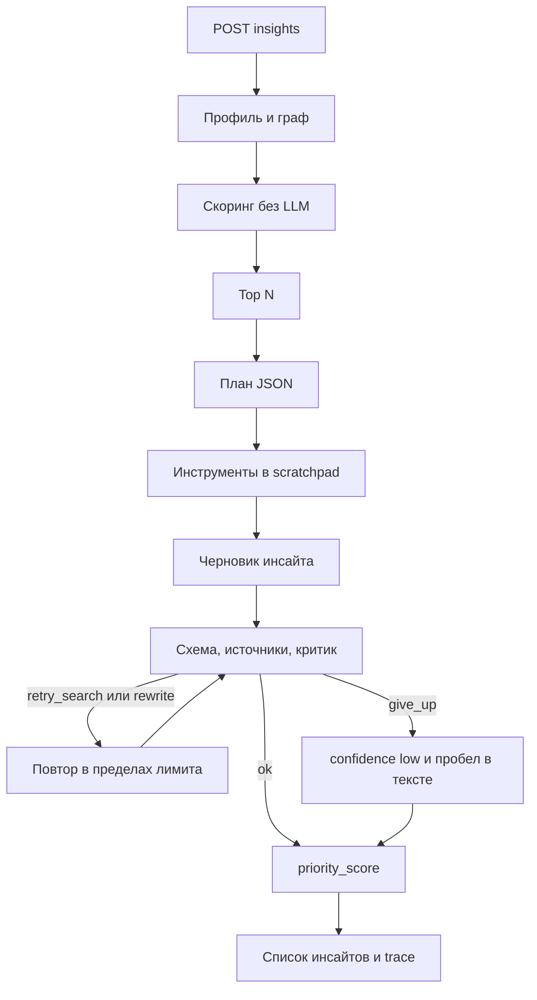

# Архитектура

Один агент на кластер. Мультиагентной схемы нет: четыре обязательных свойства (план, инструменты, общий контекст, самопроверка) видны в одном trace и стоят меньше вызовов.

Перед планом в контексте уже лежат профиль, граф и кластер. План всё равно выбирает дальнейшие инструменты: аналитику банка, макропоказатель, полный кластер. `client_id` в аргументы подставляет сессия.

## Ранг

`priority_score = relevance_score * w(impact) * w(urgency) * w(confidence)`

Веса: `high = 1.0`, `medium = 0.6`, `low = 0.3`. Результат обрезается до отрезка от 0 до 1.

`relevance_score` считается до LLM и тоже лежит в 0..1:

- совпадение отрасли клиента — до 0.35
- совпадение отрасли контрагента — до 0.15
- отрасль компании группы — 0.10, отрасль компании через связанное физлицо — 0.08; одна и та же организация не считается дважды
- регион или город — до 0.15
- чувствительность к макро и продуктам — до 0.35 (внутри этого потолка макрофактор даёт основной вклад, продуктовый признак — дополнительный)

Роль меняет веса уже найденных причин: генеральный директор усиливает отрасль, группу и спрос, финансовый директор — ставку, труд и масштаб, казначей — ставку, валюту, депозиты и контрагентов. Поэтому одна и та же лента для разных людей в компании не совпадает.

Положение в отрасли и доля считаются по выручке клиентов с тем же ОКВЭД внутри переданной выборки. Объёма всего рынка в кейсе нет, поэтому в тексте прямо сказано, что это не доля рынка.

Порог `min_relevance` и `AGENT_TOP_N` отбрасывают явно чужие кластеры. Отрасли и ключевые слова живут в `config/okved_sectors.yaml` и `config/sensitivity_rules.yaml`. Новая отрасль добавляется туда.

## Модели

План и черновик идут в `LLM_MODEL_REASONING`. Критик — в `LLM_MODEL_LIGHT`. Чат — в `LLM_MODEL_DEFAULT`. Клиент ходит в `{LLM_BASE_URL}/chat/completions`. Ответ принимается только как JSON по схеме. Кэш — файл по хэшу запроса и строка в SQLite. `MOCK_LLM=1` кэш не использует и сеть не открывает.

## Поиск по банку

Фрагменты индексируются BM25. На очень маленьком корпусе, где IDF библиотеки обнуляется, остаётся пересечение слов; на полном индексе работает BM25. Макропоказатель — это предложение из фрагмента или новости, найденное шаблоном из `config/macro_patterns.yaml`. Отдельной цифры без фразы метод не возвращает.

PDF кейса не содержат текстового слоя. Такие файлы попадают в `bank_unreadable` у `/health`. Одноимённый `.txt` рядом с PDF индексируется как текст этого документа.

## Хранение

SQLite (`AGENT_DB_PATH`): инсайты, trace, кэш LLM, отзывы «полезно / не полезно».
