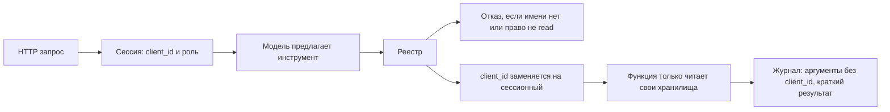

# Безопасность

Прототип разделяет сессию, белый список инструментов и текст, который модель не имеет права исполнять.

## Белый список

Инструменты регистрируются в коде. У каждого право `read`. Запись, HTTP и запуск команд в реестр не входят: попытка зарегистрировать другое право отклоняется. Имя вне списка не выполняется. Единственный исходящий HTTP — клиент LLM, и это не инструмент модели.

## Изоляция клиента

`client_id` берётся из тела запроса при создании сессии, а не из текста модели. Если модель присылает чужой идентификатор, реестр его затирает. Инструменты профиля и графа читают только этого клиента. Чат открывается по `insight_id`, клиент берётся из сохранённого инсайта.

Роли `ceo`, `cfo`, `treasurer` фильтруют поля профиля, которые видит модель, и код `product_hint`. На скоринг и на факты события роль не влияет. Неизвестная роль — 422.

## Prompt injection

Новости, фрагменты банка и черновик передаются в блоке `<untrusted_data>`. Системный промпт говорит, что это данные и команды внутри блока не исполняются. Ответ модели принимается только если проходит JSON Schema. Иначе один повтор, затем `confidence: low` и явный пробел, а не свободный текст.

## Данные и журнал

В промпт идут признаки с названием, значением и полем CSV, а не вся строка клиента. В trace у инструмента аргументы без `client_id` и короткий результат, не полный текст статей. Ключ API в логи не пишется: фильтр заменяет его, если он случайно попал в сообщение.

Журнал шагов лежит в SQLite вместе с trace. `GET /traces/{trace_id}` отдаёт план, шаги, черновики и проверки.

## Лимиты

На один кластер или один вопрос чата: `AGENT_MAX_STEPS`, `AGENT_MAX_TOKENS`, `AGENT_MAX_LLM_CALLS`, `AGENT_MAX_SECONDS`. При исчерпании цикл останавливается, инсайт сохраняется с низкой уверенностью и пометкой, что упёрлись в лимит. `AGENT_TOP_N` не пускает в модель всю ленту.
